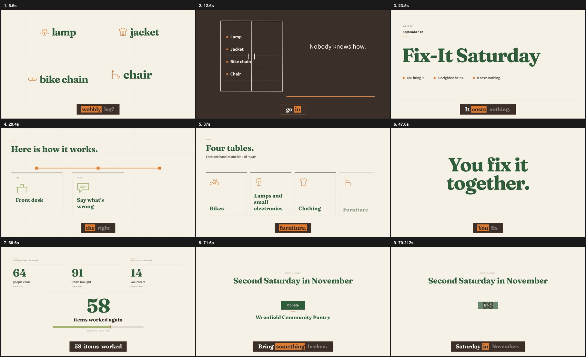
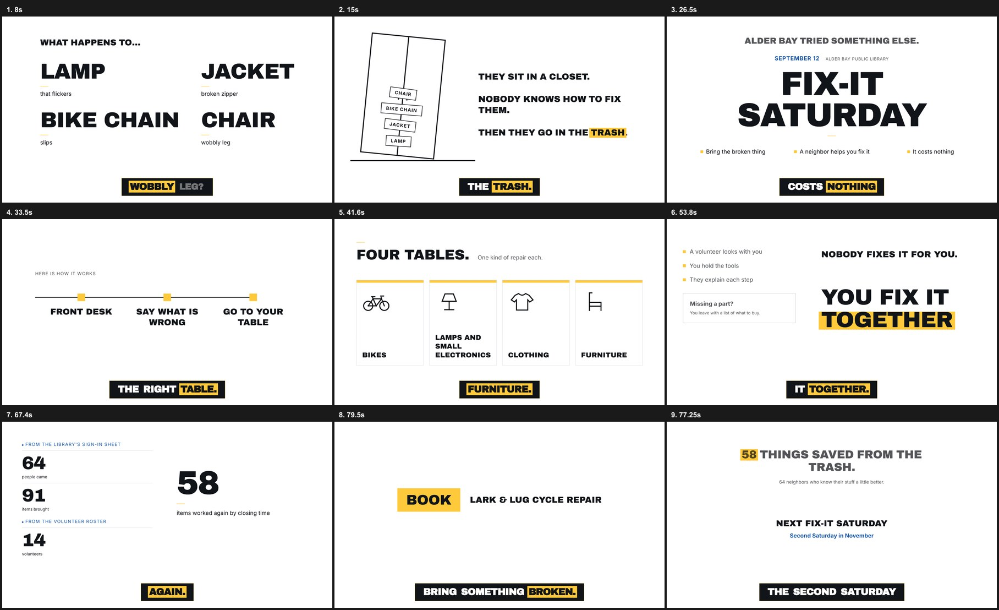

# brand-explainer

Turn an article, notes or a brief into a 60-90 second faceless explainer video in your organization's own brand. It wraps the HyperFrames `faceless-explainer` pipeline and replaces the parts where generic output drifts off brand: the design spec, the caption look, and the copy.

Set up a brand first with the [`brand-pack`](../brand-pack/SKILL.md) skill, or start from the neutral pack in [`brands/default`](../../brands/default/brand.md).

## Same script, two brands

Both videos were rendered from the identical [`example/SCRIPT.md`](example/SCRIPT.md) (sha256 `65896565e377…`), written from [`example/source.md`](example/source.md). Only the brand pack changed. Both use the free offline Kokoro voice and no music.

**Wrenfield Community Pantry** ([`fixtures/nonprofit/brand.md`](../../fixtures/nonprofit/brand.md)): Fraunces and Source Sans 3, forest, pumpkin and oat, sentence-case captions, voice `af_heart`. 72.4 s.

**Lark & Lug Cycle Repair** ([`fixtures/small-business/brand.md`](../../fixtures/small-business/brand.md)): Archivo Black and Inter, ink and signal yellow on white, uppercase captions, voice `am_michael`. 79.7 s.

Every gate passed on both: copy rules, word budget, voice clips, `hyperframes lint` and `check` (WCAG AA on all text), and render length.

## What it adds to faceless-explainer

| Script | What it does |
| --- | --- |
| `scripts/stage.ts` | Generates `frame.md` from the pack: explicit color roles, the text-legal color pairs, the CTA plate, a video-scale type ramp at the weights that ship, and `@font-face` rules. Stages the caption skin, fonts and logo. |
| `scripts/check-copy.ts` | Gates script, storyboard, built frames and caption words against the pack's `copy_rules`, and lists every figure for sign-off against the source. |
| `scripts/verify.ts` | `words` (budget from `lib/pacing.json`), `audio` (every line voiced, total in range), `captions` (caption words match the script), `render` (MP4 length), `ground` (video background color). |

## Requirements

- Node 22.18 or later, and ffmpeg.
- The HyperFrames skills installed side by side (`faceless-explainer`, `hyperframes`, `hyperframes-creative`, `media-use`). Tested with `hyperframes@0.8.91`.
- A voice:
  - **Kokoro**, free and offline: `pip install kokoro-onnx soundfile`, plus a ~338 MB model download on first use. Captions also need whisper.cpp, which HyperFrames installs on first use.
  - **HeyGen**, through `npx hyperframes auth login`. Output is yours to redistribute only on a paid plan.

## Cost

A local render with Kokoro costs nothing in API fees; each example took about 1.5 minutes to render. The largest cost is agent tokens, since frames are built by one sub-agent each.
