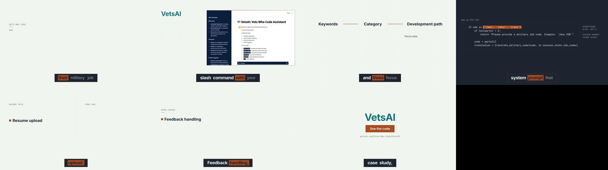

# project-demo

Point it at a portfolio repo and get a case study with a hero image and an audio overview, plus a 60-second demo video in your own brand. It reads the code and the README. It does not invent features: every feature in the case study cites a code line that exists, every decision names its source, and anything the README promises that the code doesn't do is called out in the open.

Built from [`blog-media`](../blog-media/README.md) (image and audio) and [`brand-explainer`](../brand-explainer/README.md) (video). Set up a brand with [`brand-pack`](../brand-pack/SKILL.md) or use [`brands/default`](../../brands/default/brand.md).

## Before and after

**Before:** [`fixtures/project`](../../fixtures/project/), a fictional two-file Node CLI whose README promises a PDF report that the code doesn't have. The test suite replays it as a git repo with two commits (the trade-off lives in a commit body, as in real repos); here it was replayed to `~/trail-counter`.

```sh
node skills/project-demo/scripts/ingest.ts ~/trail-counter        # a local repo, or a GitHub URL
```

```
/Users/mara/trail-counter @ 9e7ae8f: 6 files, 6 read, 2 source files excerpted, 2 commits, GitHub metadata not fetched
/Users/mara/.cache/hashflag/project-demo/trail-counter/source-brief.md
/Users/mara/.cache/hashflag/project-demo/trail-counter/repo.json
```

**After:** [`example/case-study.md`](example/case-study.md), written from that brief and passed through the gate. The paragraph that matters most:

> Claimed in the README but not in the code: the monthly PDF report (`README.md:12`). The `report` command is in the help text (`src/cli.js:10`) but has no handler; it falls through to the usage message (`src/cli.js:29-30`). The `pdfPageSize` setting (`package.json:13`) is read by nothing.

```
$ node skills/project-demo/scripts/check-study.ts case-study.md --repo repo
ok: 5 sections, 17 citations resolve in repo
```

**On a real repo.** Run against [VetsAI](https://github.com/Vets-Who-Code/VetsAI) at `cd3f1c8` (a Streamlit chat app from the Vets Who Code projects catalog), the case study passed with 41 citations and reported three gaps the README hides: resume upload is promised in three places and listed as two dependencies, but neither library is in `requirements.txt` and the only input is the chat box; three advertised slash commands have no handler; and the README's `.env` setup doesn't match the code, which reads Streamlit secrets. Against [vets-who-code-app](https://github.com/Vets-Who-Code/vets-who-code-app) at `04b4f8a` (972 files, 15 merged PRs read), it passed with 33 citations and found the Dockerfile on Node 18 while the README, `.nvmrc` and `engines` say 24.

**The demo video**, rendered from the VetsAI case study with `brand-explainer` and the neutral default pack (its CTA pointed at the repo), the free Kokoro voice `am_michael`, and no music. Seven frames, 167 spoken words, 64.5 s; every gate passed: copy rules, word budget, voice clips, captions, `hyperframes lint` and `check` (WCAG AA on all text), and render length. Frame 2 is the project's real screenshot; frame 4 is the six-line excerpt from `app.py:351-356`, verbatim.



## What the gate refuses

`scripts/check-study.ts` exits 1 when:

- the five sections aren't there, in order, and nothing else;
- a feature bullet has no `` `path:line` `` citation, or cites a doc instead of code;
- a citation points outside the file or outside the repo;
- a decision or roadmap bullet has no source: `(PR #N, name)`, `(commit <sha>, name)`, `(issue #N)`, a citation, `(from the builder)` or `(not stated in the repo)`;
- a number sits on a line with no citation or source.

## What the ingest reads

`scripts/ingest.ts` clones at depth 50 and writes `source-brief.md` from: README (line-numbered), manifests, run scripts and CI, entry points and the largest product source files (line-numbered, with a definitions outline past the budget), tests, TODO lines, roadmap and changelog, the last 20 human commits with bodies, and with `gh` signed in the merged PR bodies with authors, open issues and contributors with names. Lockfiles, build output, binaries, and any folder with more than 100 files directly in it (VetsAI's job-code dumps) are listed, not read. Dependabot and other bots are skipped.

## Requirements

- Node 22.18 or later, git, and `gh` signed in for GitHub metadata (`gh auth status --active`; a local repo with no GitHub origin runs in git-only mode).
- For the image and audio: what `blog-media` needs (`GEMINI_API_KEY` on a billed project).
- For the video: what `brand-explainer` needs (the HyperFrames skills, ffmpeg, and Kokoro or HeyGen).

## Cost

The ingest and the gate are free. For the VetsAI case study (678 words), `blog-media --dry` estimated $0.19 to $0.59 for the hero image and audio. The video costs nothing in API fees with Kokoro; its cost is agent time, since every frame is built by a sub-agent.

## Privacy

The target's code is never run and its `.env` is never read. Only the case study text goes to a paid API, never source files. Output lives in `~/.cache/hashflag/project-demo/<slug>/`, outside the repo.
